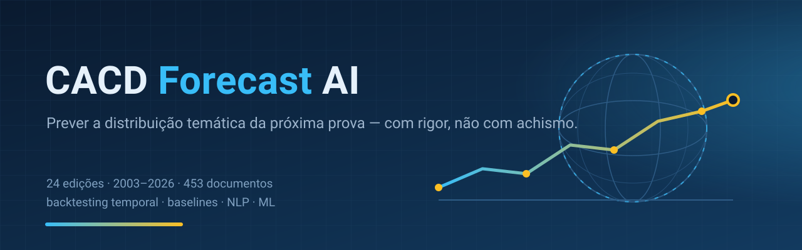

<p align="center">
  
</p>

<p align="center">
  
  
  
  
</p>

# CACD Forecast AI

**Dá para prever os temas da próxima prova do CACD olhando só para as provas anteriores?**

Este projeto responde a essa pergunta com dados. Ele reúne as provas objetivas do
**Concurso de Admissão à Carreira de Diplomata** de 2003 a 2026, classifica cada item por tema e
testa, ano a ano, se um modelo treinado só com o passado acerta os temas da edição seguinte
melhor do que uma regra estatística simples.

> **EN — TL;DR.** Can 23 editions (2003–2026) of the Brazilian diplomat entrance exam predict
> the *topics* of the next one? We build the dataset, run a leakage-free temporal backtest, and
> compare ML models against simple statistical baselines. A "no" is a valid answer.

---

## O que é e o que não é

| É | Não é |
|---|---|
| Uma pesquisa com backtesting temporal: treina até o ano X, testa em X+1 | Adivinhação da questão literal |
| Uma comparação honesta entre baselines simples e modelos de ML | Promessa de tema garantido |
| Um dataset aberto e rastreável das provas objetivas do CACD | Material oficial do MRE, do IRBr ou das bancas |

## Situação atual

| | |
|---|---|
| **Dataset** | 5.038 itens da 1ª fase, 23 edições, 96,5% com gabarito oficial |
| **Qualidade** | 88% de fidelidade numa revisão manual de 50 questões (meta: 97%) |
| **Temas** | 60 temas em 8 disciplinas |
| **Melhor baseline** | Markov por tema: Precision@K = **0,79** |
| **Modelo que supera o baseline** | Ainda nenhum — é o próximo grande marco |

### Marcos

| Marco | Objetivo | Status |
|---|---|---|
| M0 — Corpus | Baixar e extrair o texto de todas as provas | ✅ |
| M1 — Dados confiáveis | Dataset da 1ª fase sem lixo e com gabarito documentado | 🔄 |
| M2 — Temas | Cada item com um tema, em uma taxonomia versionada | 🔄 |
| M3 — Avaliação honesta | Um protocolo único de backtest, sem vazamento | 🔄 |
| M4 — Modelos | Regressão logística e XGBoost contra o baseline | ⬜ |
| M5 — Reprodutibilidade | Manifest, testes, comando único, CI | ⬜ |
| M6 — Fechamento | Relatório final e versão `v1.0` | ⬜ |

Detalhes: **[status e ganhos](docs/MAPA-DO-PROJETO.md)** · **[roadmap até o fim](docs/ROADMAP.md)**

---

## Como funciona

```
 PDFs oficiais ──► texto ──► questões + gabarito ──► tema de cada item ──► backtest por ano
   (scraper)      (parser)      (parser, pipeline)       (pipeline)          (evaluation)
```

1. **Coleta** — cada PDF é catalogado com a URL de origem e o hash SHA-256.
2. **Extração** — o texto sai do PDF (PyMuPDF; OCR com Tesseract nos escaneados) e é segmentado
   em questões e itens por um parser específico de cada banca (CESPE, IADES, Cebraspe).
3. **Gabarito** — as respostas oficiais são lidas dos gabaritos definitivos; itens anulados ficam sem resposta.
4. **Temas** — cada item recebe uma disciplina (8) e um tema (60).
5. **Backtest** — para cada ano X de 2017 a 2025, os métodos veem só as provas até X e apostam
   nos K temas de X+1. A métrica principal é **Precision@K por tema**.

## Stack

| Camada | Ferramentas |
|---|---|
| Linguagem | Python 3.12+ |
| Dados | pandas, pyarrow (Parquet) |
| PDFs e OCR | PyMuPDF, Tesseract 5 + `pytesseract`, Pillow |
| Validação de esquema | pydantic, pandera |
| NLP e métricas | scikit-learn (TF-IDF, métricas) |
| Gráficos | matplotlib |
| Coleta | requests |
| Planejado (M4) | XGBoost / LightGBM, sentence-transformers |

## Estrutura

```
├── data/
│   ├── raw/                  # PDFs originais + download_manifest.csv (URL, SHA-256)
│   ├── metadata/             # catálogos de fontes
│   ├── processed/            # questions.parquet, gabaritos, amostras de QA
│   └── resultados/           # saídas do backtest
├── scraper/                  # download dos PDFs
├── parser/                   # extração de texto e parsers por banca
├── pipeline/                 # scripts de produção, em ordem (ver pipeline/README.md)
├── evaluation/               # baselines, métricas @K e backtest
├── ferramentas/
│   ├── extracoes_pontuais/   # OCR e resgates feitos uma única vez
│   └── diagnostico/          # inspeção e depuração
├── tests/                    # pytest
└── docs/
    ├── MAPA-DO-PROJETO.md    # objetivo, marcos, ganhos, glossário
    ├── ROADMAP.md            # tarefas até o fim do projeto
    ├── referencia/           # requisitos, specs técnicas, formatos dos PDFs
    ├── relatorios/           # relatórios de corpus e cobertura
    └── historico/            # planos e anotações de sessões antigas
```

## O dataset

`data/processed/questions.parquet` — uma linha por item.

| Coluna | Significado |
|---|---|
| `contest_id` | Edição, ex.: `CACD_2017` |
| `stage` | `primeira_fase` (objetiva), `segunda_fase`, `terceira_fase` (discursivas) |
| `question_number` / `item_number` | Número da questão e do item dentro dela |
| `question_text` / `item_text` | Enunciado e texto do item |
| `answer` | Gabarito oficial (`C`/`E` ou letra); vazio se anulado |
| `discipline_canon` | Uma das 8 disciplinas |
| `topic` | Tema — o que o projeto tenta prever |
| `extraction_method` | `manual` (transcrito/revisado) ou `rules` (extraído automaticamente) |
| `source_type` / `source_file` | Origem do dado, rastreável ao PDF |

Mais termos no [glossário](docs/MAPA-DO-PROJETO.md#5-glossário-nomes-usados-no-código).

### Proveniência

Prioridade de fonte: **MRE/IRBr > Cebraspe > Wayback (oficial arquivado) > repositórios secundários**.

| Período | Banca | Fonte |
|---|---|---|
| 2003–2012 | CESPE | secundária |
| 2013–2016 | CESPE | oficial arquivada (Wayback) |
| 2017–2018 | Cebraspe | oficial |
| 2019–2023 | IADES | secundária |
| 2024–2026 | Cebraspe | oficial |

Os PDFs originais ficam no repositório (`data/raw/`) para que qualquer pessoa confira as fontes.

## Como rodar

```bash
pip install -r requirements.txt

# reconstruir o dataset a partir dos PDFs
python scraper/download.py          # baixa (retomável, confere SHA-256)
python parser/extract_text.py       # PDF → texto
python parser/build_dataset.py      # texto → questions.parquet

# backtest
python evaluation/backtest_temas.py # baselines por tema → data/resultados/
python evaluation/grafico.py        # gráfico → docs/assets/precision_at_k.png
```

O pipeline completo (importação manual, gabaritos, taxonomia) tem uma **ordem obrigatória**:
veja [`pipeline/README.md`](pipeline/README.md).

## Princípios

- **Sem vazamento** — nada da prova X+1 entra no treino, nas features ou na definição dos temas.
- **Baseline antes de IA** — nenhum modelo vale se não superar frequência, recência e Markov.
- **Incerteza explícita** — todo resultado vem com intervalo de confiança; nada é certeza.
- **Rastreabilidade** — cada item aponta para o PDF e a URL de origem.
- **Resultado negativo também é resultado** — se o histórico não prever, isso será publicado.

## Aviso

Projeto de **pesquisa e estudo**, sem vínculo com o Ministério das Relações Exteriores, o Instituto
Rio Branco, o Cebraspe ou o IADES. Não há garantia de acurácia.

## Licença

- **Código:** MIT — [`LICENSE`](LICENSE)
- **Dados derivados e documentação:** CC BY 4.0 — [`LICENSE-DATA.md`](LICENSE-DATA.md)
